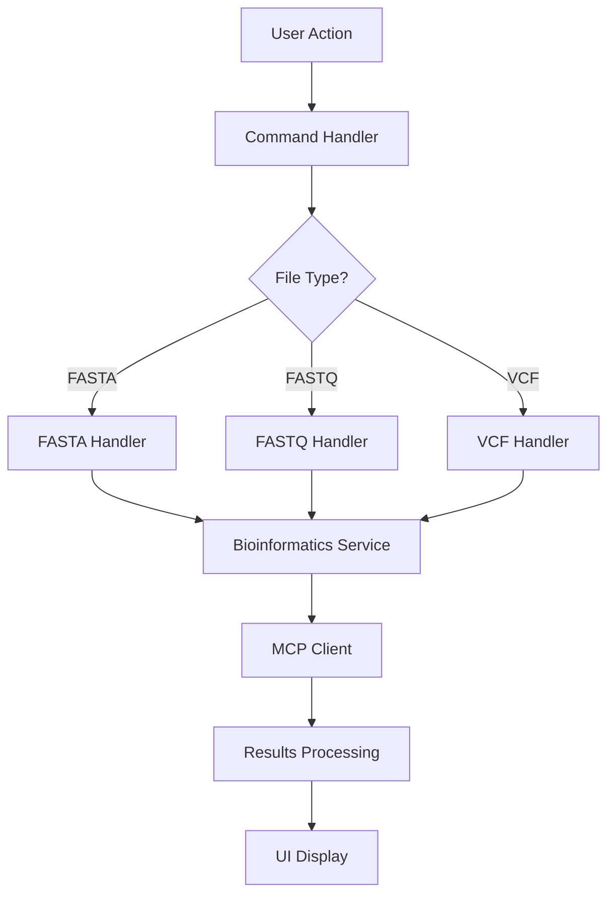

# Biomni VSCode Extension - Developer Contribution Guide

## Welcome Contributors! 

We're excited to have you contribute to the Biomni VSCode Extension. This guide will help you get started, whether you're fixing bugs, adding features, or improving documentation.

## Quick Start for Contributors

### Prerequisites

- **Node.js**: Version 18.x or 20.x
- **VS Code**: Version 1.90.0 or higher
- **Git**: For version control
- **TypeScript**: Familiarity recommended
- **Bioinformatics**: Basic understanding helpful but not required

### Development Environment Setup

1. **Fork and Clone Repository**:
   ```bash
   # Fork the repository on GitHub first
   git clone https://github.com/YOUR_USERNAME/epic-vscode-extension.git
   cd epic-vscode-extension
   
   # Add upstream remote
   git remote add upstream https://github.com/manu-tej/epic-vscode-extension.git
   ```

2. **Install Dependencies**:
   ```bash
   npm install
   ```

3. **Compile TypeScript**:
   ```bash
   npm run compile
   ```

4. **Launch Development Host**:
   - Open the project in VS Code
   - Press `F5` to launch Extension Development Host
   - A new VS Code window opens with your extension loaded

5. **Verify Setup**:
   - In the development host, open Command Palette (`Ctrl+Shift+P`)
   - Type "Biomni" - you should see extension commands
   - Test basic functionality with a sample FASTA file

## Project Architecture

### Directory Structure

```
epic-vscode-extension/
├── src/                          # Source code
│   ├── extension.ts              # Main extension entry point
│   ├── biomni/                   # Core Biomni functionality
│   │   ├── mcpClient.ts         # MCP client implementation
│   │   ├── fileDetection.ts     # Biological file type detection
│   │   ├── blastService.ts      # BLAST search functionality
│   │   ├── alignmentService.ts  # Sequence alignment
│   │   └── annotationService.ts # Variant annotation
│   ├── types/                    # TypeScript type definitions
│   │   ├── config.ts            # Configuration types
│   │   ├── biomni.ts            # Biomni-specific types
│   │   └── index.ts             # Type exports
│   ├── utils/                    # Utility functions
│   │   ├── fileUtils.ts         # File handling utilities
│   │   ├── sequenceUtils.ts     # Sequence manipulation
│   │   └── validationUtils.ts   # Data validation
│   └── webview/                  # UI components
│       ├── settings/            # Settings panel
│       ├── results/             # Results viewers
│       └── shared/              # Shared components
├── test/                        # Test files
│   ├── setup.ts                # Test configuration
│   ├── extension.test.ts       # Extension tests
│   ├── biomni/                 # Component tests
│   └── fixtures/               # Test data files
├── out/                        # Compiled JavaScript (generated)
├── docs/                       # Documentation
├── syntaxes/                   # Language grammars
├── package.json                # Extension manifest
├── tsconfig.json              # TypeScript configuration
└── jest.config.js             # Test configuration
```

### Key Components

#### 1. Extension Entry Point (`src/extension.ts`)
- Extension activation and deactivation
- Command registration
- Configuration management
- Event handling

#### 2. MCP Client (`src/biomni/mcpClient.ts`)
- Communication with Biomni MCP servers
- Protocol implementation
- Connection management
- Error handling

#### 3. File Detection (`src/biomni/fileDetection.ts`)
- Automatic file type recognition
- Format validation
- Metadata extraction
- Statistics calculation

#### 4. Bioinformatics Services
- **BLAST Service**: Sequence similarity searches
- **Alignment Service**: Multiple sequence alignments
- **Annotation Service**: Variant and sequence annotation

### Data Flow



## Development Workflow

### Branch Strategy

We follow a **Git Flow** approach:

- **`main`**: Production-ready code
- **`develop`**: Integration branch for features
- **Feature branches**: `feature/description` or `feature/issue-number`
- **Bug fixes**: `bugfix/description` or `fix/issue-number`
- **Documentation**: `docs/description`

### Creating a Feature Branch

```bash
# Ensure you're on develop and up-to-date
git checkout develop
git pull upstream develop

# Create feature branch
git checkout -b feature/blast-parameter-validation

# Make your changes...
# Commit frequently with clear messages
git add .
git commit -m "feat: add parameter validation for BLAST searches"

# Push to your fork
git push origin feature/blast-parameter-validation
```

### Development Commands

```bash
# Watch mode for development (auto-recompile on changes)
npm run watch

# Run tests
npm test

# Run tests in watch mode
npm run test:watch

# Run tests with coverage
npm run test:coverage

# Lint code
npm run lint

# Fix linting issues automatically
npm run lint:fix

# Build for production
npm run build

# Create VSIX package
npm run package
```

### Testing Your Changes

1. **Unit Tests**: Add tests for new functions and modules
2. **Integration Tests**: Test command execution and UI interactions
3. **Manual Testing**: Use Extension Development Host for hands-on testing
4. **Performance Testing**: Ensure changes don't degrade performance

#### Running Tests

```bash
# Run all tests
npm test

# Run specific test file
npm test -- extension.test.ts

# Run tests with debugging
npm test -- --detectOpenHandles --verbose

# Generate coverage report
npm run test:coverage
```

#### Writing Tests

Follow these patterns for different test types:

**Unit Test Example**:
```typescript
// test/utils/sequenceUtils.test.ts
import { calculateGCContent, reverseComplement } from '../../src/utils/sequenceUtils';

describe('sequenceUtils', () => {
  describe('calculateGCContent', () => {
    it('should calculate GC content correctly', () => {
      expect(calculateGCContent('ATGC')).toBe(50);
      expect(calculateGCContent('AAAA')).toBe(0);
      expect(calculateGCContent('GCGC')).toBe(100);
    });

    it('should handle empty sequences', () => {
      expect(calculateGCContent('')).toBe(0);
    });

    it('should ignore non-ATGC characters', () => {
      expect(calculateGCContent('ATGCN')).toBe(50);
    });
  });
});
```

**Command Test Example**:
```typescript
// test/commands/blast.test.ts
import * as vscode from 'vscode';
import { executeCommand } from '../helpers/commandHelper';

describe('BLAST Command', () => {
  it('should execute BLAST search with valid parameters', async () => {
    const result = await executeCommand('biomni.fasta.blast', {
      sequence: 'ATGCATGCATGC',
      database: 'nt',
      eValue: 0.01
    });

    expect(result).toBeDefined();
    expect(result.hits).toBeInstanceOf(Array);
    expect(result.queryLength).toBe(12);
  });

  it('should handle invalid sequences gracefully', async () => {
    await expect(
      executeCommand('biomni.fasta.blast', { sequence: '' })
    ).rejects.toThrow('Invalid sequence');
  });
});
```

## Coding Standards

### TypeScript Guidelines

1. **Type Safety**: Use strict TypeScript settings
   ```typescript
   // Good
   function calculateLength(sequence: string): number {
     return sequence.length;
   }

   // Avoid
   function calculateLength(sequence: any) {
     return sequence.length;
   }
   ```

2. **Interface Definitions**: Define clear interfaces
   ```typescript
   interface BlastResult {
     accession: string;
     description: string;
     eValue: number;
     bitScore: number;
     identity: number;
     coverage: number;
   }
   ```

3. **Error Handling**: Use specific error types
   ```typescript
   class BiomniError extends Error {
     constructor(
       message: string,
       public code: string,
       public context?: Record<string, any>
     ) {
       super(message);
       this.name = 'BiomniError';
     }
   }
   ```

### Code Style

We use **ESLint** and **Prettier** for consistent code formatting:

```bash
# Check code style
npm run lint

# Auto-fix style issues
npm run lint:fix
```

#### Key Style Guidelines

- **Indentation**: 2 spaces
- **Quotes**: Single quotes for strings
- **Semicolons**: Always use semicolons
- **Line Length**: 100 characters maximum
- **Naming**: camelCase for variables/functions, PascalCase for classes/interfaces

#### Example of Good Code Style

```typescript
interface SequenceInfo {
  id: string;
  sequence: string;
  length: number;
  type: 'dna' | 'rna' | 'protein';
}

class SequenceAnalyzer {
  private readonly sequences: SequenceInfo[];

  constructor(sequences: SequenceInfo[]) {
    this.sequences = sequences;
  }

  public analyzeComposition(): Map<string, number> {
    const composition = new Map<string, number>();
    
    for (const seq of this.sequences) {
      const bases = seq.sequence.split('');
      bases.forEach(base => {
        composition.set(base, (composition.get(base) || 0) + 1);
      });
    }

    return composition;
  }
}
```

### Documentation Standards

#### Code Comments

```typescript
/**
 * Calculates the GC content percentage of a DNA sequence.
 * @param sequence - DNA sequence containing only ATGC characters
 * @returns GC content as percentage (0-100)
 * @throws {BiomniError} When sequence contains invalid characters
 * @example
 * ```typescript
 * const gcContent = calculateGCContent('ATGC');
 * console.log(gcContent); // 50
 * ```
 */
export function calculateGCContent(sequence: string): number {
  // Implementation...
}
```

#### README Updates

When adding new features, update relevant documentation:
- Feature descriptions in README.md
- Configuration options in docs/
- API documentation
- Video tutorial scripts (if applicable)

## Contribution Types

### Bug Fixes

1. **Report the Bug**: Create GitHub issue with:
   - Steps to reproduce
   - Expected behavior
   - Actual behavior
   - VS Code version, OS, extension version
   - Sample files (if applicable)

2. **Fix the Bug**:
   - Create bugfix branch
   - Add test that reproduces the bug
   - Implement fix
   - Verify test passes
   - Update documentation if needed

3. **Example Bug Fix Commit**:
   ```
   fix(blast): handle empty sequences in BLAST search

   - Add validation for empty sequence input
   - Return appropriate error message
   - Add test case for empty sequence handling
   
   Closes #123
   ```

### Feature Additions

1. **Feature Proposal**: 
   - Create GitHub issue or discussion
   - Describe use case and benefits
   - Get community feedback

2. **Implementation**:
   - Follow architecture patterns
   - Add comprehensive tests
   - Update documentation
   - Consider backwards compatibility

3. **Example Feature Commit**:
   ```
   feat(alignment): add support for MAFFT algorithm

   - Implement MAFFT alignment service
   - Add configuration options for MAFFT parameters
   - Add tests for MAFFT functionality
   - Update API documentation

   Resolves #456
   ```

### Documentation Improvements

1. **Types of Documentation**:
   - User guides and tutorials
   - API documentation
   - Code comments
   - Video tutorial scripts
   - Troubleshooting guides

2. **Documentation Standards**:
   - Clear, concise language
   - Step-by-step instructions
   - Code examples that work
   - Screenshots (when helpful)
   - Accessibility considerations

3. **Example Documentation Commit**:
   ```
   docs: add troubleshooting guide for BLAST connection issues

   - Document common connection problems
   - Add step-by-step solutions
   - Include network configuration examples
   - Add accessibility notes for screen readers
   ```

## Pull Request Process

### Before Submitting

1. **Code Quality**:
   - [ ] All tests pass (`npm test`)
   - [ ] No linting errors (`npm run lint`)
   - [ ] Code coverage maintained or improved
   - [ ] No TypeScript errors (`npm run compile`)

2. **Documentation**:
   - [ ] README updated (if needed)
   - [ ] API docs updated (for new commands/features)
   - [ ] Code comments added for complex logic
   - [ ] CHANGELOG entry added

3. **Testing**:
   - [ ] New tests added for new functionality
   - [ ] Existing tests still pass
   - [ ] Manual testing completed in Extension Development Host
   - [ ] Edge cases considered and tested

### Pull Request Template

When creating a PR, use this template:

```markdown
## Description
Brief description of changes made.

## Type of Change
- [ ] Bug fix (non-breaking change that fixes an issue)
- [ ] New feature (non-breaking change that adds functionality)
- [ ] Breaking change (fix or feature that would cause existing functionality to not work as expected)
- [ ] Documentation update

## Testing
- [ ] Added new tests
- [ ] All existing tests pass
- [ ] Manual testing completed

## Related Issues
Closes #issue_number

## Screenshots (if applicable)
Include screenshots of UI changes or new features.

## Checklist
- [ ] Code follows project style guidelines
- [ ] Self-review completed
- [ ] Documentation updated
- [ ] No breaking changes (or clearly documented)
```

### Review Process

1. **Automated Checks**: GitHub Actions run tests and linting
2. **Code Review**: Maintainers review code quality and design
3. **Testing**: Reviewers test functionality manually
4. **Documentation**: Review documentation changes
5. **Approval**: At least one maintainer approval required
6. **Merge**: Squash and merge to maintain clean history

## Advanced Development Topics

### Extension Architecture Patterns

#### Command Pattern
```typescript
// src/commands/baseCommand.ts
export abstract class BaseCommand {
  abstract execute(...args: any[]): Promise<any>;
  
  protected handleError(error: Error): void {
    console.error(`Command failed: ${error.message}`);
    vscode.window.showErrorMessage(`Operation failed: ${error.message}`);
  }
}

// src/commands/blastCommand.ts
export class BlastCommand extends BaseCommand {
  async execute(options: BlastOptions): Promise<BlastResult> {
    try {
      // Implementation...
    } catch (error) {
      this.handleError(error);
      throw error;
    }
  }
}
```

#### Service Layer Pattern
```typescript
// src/services/sequenceService.ts
export class SequenceService {
  private mcpClient: McpClient;

  constructor(mcpClient: McpClient) {
    this.mcpClient = mcpClient;
  }

  async analyzeSequence(sequence: string): Promise<SequenceAnalysis> {
    // Coordinate with MCP server and local analysis
  }
}
```

### Configuration Management

#### Settings Schema
```typescript
// src/types/config.ts
export interface BiomniConfig {
  extension: {
    core: {
      enabled: boolean;
      mcpServerUrl: string;
      autoActivate: boolean;
    };
    fileDetection: {
      enabled: boolean;
      showSmartSuggestions: boolean;
    };
  };
  tools: {
    blast: BlastConfig;
    alignment: AlignmentConfig;
  };
  performance: PerformanceConfig;
}
```

#### Configuration Access
```typescript
// src/utils/configUtils.ts
export function getBlastConfig(): BlastConfig {
  const config = vscode.workspace.getConfiguration('biomni.tools.blast');
  return {
    database: config.get('database', 'nt'),
    eValue: config.get('eValue', 0.01),
    maxTargetSequences: config.get('maxTargetSequences', 500)
  };
}
```

### Error Handling Strategy

#### Error Types
```typescript
// src/types/errors.ts
export class BiomniError extends Error {
  constructor(
    message: string,
    public code: string,
    public context?: Record<string, any>,
    public suggestions?: string[]
  ) {
    super(message);
    this.name = 'BiomniError';
  }
}

export const ErrorCodes = {
  MCP_SERVER_UNREACHABLE: 'MCP_SERVER_UNREACHABLE',
  INVALID_FILE_FORMAT: 'INVALID_FILE_FORMAT',
  NETWORK_ERROR: 'NETWORK_ERROR',
  QUOTA_EXCEEDED: 'QUOTA_EXCEEDED'
} as const;
```

#### Error Handler
```typescript
// src/utils/errorHandler.ts
export function handleBiomniError(error: BiomniError): void {
  console.error('Biomni Error:', error);
  
  let message = error.message;
  if (error.suggestions && error.suggestions.length > 0) {
    message += ` Suggestions: ${error.suggestions.join(', ')}`;
  }

  switch (error.code) {
    case ErrorCodes.MCP_SERVER_UNREACHABLE:
      vscode.window.showErrorMessage(message, 'Check Configuration', 'Retry')
        .then(action => {
          if (action === 'Check Configuration') {
            vscode.commands.executeCommand('biomni.settings.openPanel');
          }
        });
      break;
    default:
      vscode.window.showErrorMessage(message);
  }
}
```

## Performance Considerations

### Large File Handling

```typescript
// src/utils/fileUtils.ts
export async function readLargeFile(uri: vscode.Uri): Promise<string> {
  const stat = await vscode.workspace.fs.stat(uri);
  const maxSize = 100 * 1024 * 1024; // 100MB

  if (stat.size > maxSize) {
    const choice = await vscode.window.showWarningMessage(
      `File is large (${(stat.size / 1024 / 1024).toFixed(1)}MB). This may affect performance.`,
      'Open Anyway', 'Cancel'
    );
    
    if (choice !== 'Open Anyway') {
      throw new BiomniError('Operation cancelled by user', 'USER_CANCELLED');
    }
  }

  // Stream processing for large files
  return processFileInChunks(uri);
}
```

### Caching Strategy

```typescript
// src/utils/cache.ts
export class ResultCache {
  private cache = new Map<string, { data: any; timestamp: number; ttl: number }>();

  set(key: string, data: any, ttl: number = 3600): void {
    this.cache.set(key, {
      data,
      timestamp: Date.now(),
      ttl: ttl * 1000
    });
  }

  get(key: string): any | null {
    const entry = this.cache.get(key);
    if (!entry) return null;

    if (Date.now() - entry.timestamp > entry.ttl) {
      this.cache.delete(key);
      return null;
    }

    return entry.data;
  }
}
```

## Security Guidelines

### Data Handling

1. **Sensitive Data**: Never log sensitive information (API keys, personal data)
2. **User Input**: Always validate and sanitize user input
3. **External Connections**: Use HTTPS for all external API calls
4. **File Access**: Respect VS Code's security model

### Example Secure Implementation

```typescript
// src/services/apiService.ts
export class ApiService {
  private apiKey: string;

  constructor() {
    // Safely retrieve API key from secure storage
    this.apiKey = this.getApiKeySecurely();
  }

  private getApiKeySecurely(): string {
    // Use VS Code's secret storage for API keys
    const secrets = vscode.extensions.getExtension('biomni.biomni-mcp-integration')?.secrets;
    return secrets?.get('api-key') || '';
  }

  async makeSecureRequest(url: string, data: any): Promise<any> {
    // Validate URL is in allowed hosts
    if (!this.isAllowedHost(url)) {
      throw new BiomniError('Host not allowed', 'SECURITY_VIOLATION');
    }

    // Sanitize data
    const sanitizedData = this.sanitizeInput(data);

    // Make request with proper headers
    const response = await fetch(url, {
      method: 'POST',
      headers: {
        'Authorization': `Bearer ${this.apiKey}`,
        'Content-Type': 'application/json',
        'User-Agent': 'Biomni-VSCode-Extension/1.0'
      },
      body: JSON.stringify(sanitizedData)
    });

    return response.json();
  }
}
```

## Release Process

### Versioning

We follow **Semantic Versioning** (SemVer):
- **MAJOR**: Breaking changes
- **MINOR**: New features (backwards compatible)
- **PATCH**: Bug fixes (backwards compatible)

### Release Checklist

1. **Pre-Release**:
   - [ ] All tests passing
   - [ ] Documentation updated
   - [ ] CHANGELOG.md updated
   - [ ] Version number bumped in package.json
   - [ ] Manual testing completed

2. **Release**:
   - [ ] Create release branch
   - [ ] Final testing
   - [ ] Create GitHub release
   - [ ] Publish to VS Code Marketplace
   - [ ] Update documentation site

3. **Post-Release**:
   - [ ] Monitor for issues
   - [ ] Update social media/announcements
   - [ ] Plan next release cycle

## Community Guidelines

### Communication

- **Be Respectful**: Treat all contributors with respect
- **Be Constructive**: Provide helpful feedback and suggestions
- **Be Patient**: Remember that everyone is volunteering their time
- **Be Inclusive**: Welcome contributors of all skill levels

### Getting Help

1. **Documentation**: Check existing docs first
2. **GitHub Discussions**: Ask questions in discussions
3. **GitHub Issues**: Report bugs and request features
4. **Discord/Slack**: Real-time chat (if available)

### Mentorship

We encourage experienced contributors to mentor newcomers:
- Label issues as "good first issue" for beginners
- Provide detailed code review feedback
- Offer pairing sessions for complex features
- Share knowledge in documentation and discussions

## Troubleshooting Development Issues

### Common Problems

#### Extension Won't Load
```bash
# Check for compilation errors
npm run compile

# Clear VS Code cache
rm -rf ~/.vscode/extensions/ms-vscode.vscode-typescript-*
```

#### Tests Failing
```bash
# Clear test cache
npm run test -- --clearCache

# Run single test for debugging
npm run test -- --testNamePattern="specific test name"
```

#### TypeScript Errors
```bash
# Check TypeScript configuration
npx tsc --noEmit

# Update type definitions
npm update @types/vscode
```

### Getting Unstuck

1. **Read Error Messages Carefully**: Often contain the solution
2. **Check Recent Changes**: Use `git diff` to see what changed
3. **Search Issues**: Someone might have had the same problem
4. **Ask for Help**: Don't hesitate to ask in discussions
5. **Start Fresh**: Sometimes a clean clone helps

---

## Conclusion

Contributing to Biomni is a great way to learn about VS Code extension development, bioinformatics, and open source collaboration. Whether you're fixing a small bug or implementing a major feature, your contributions help make bioinformatics more accessible to researchers worldwide.

Thank you for contributing to Biomni! 🧬

## Additional Resources

- [VS Code Extension API](https://code.visualstudio.com/api)
- [TypeScript Handbook](https://www.typescriptlang.org/docs/)
- [Jest Testing Framework](https://jestjs.io/docs/getting-started)
- [Bioinformatics File Formats](https://en.wikipedia.org/wiki/List_of_file_formats#Bioinformatics)
- [Model Context Protocol](https://github.com/microsoft/model-context-protocol)

---

*This guide is a living document. Please suggest improvements and updates as the project evolves.*